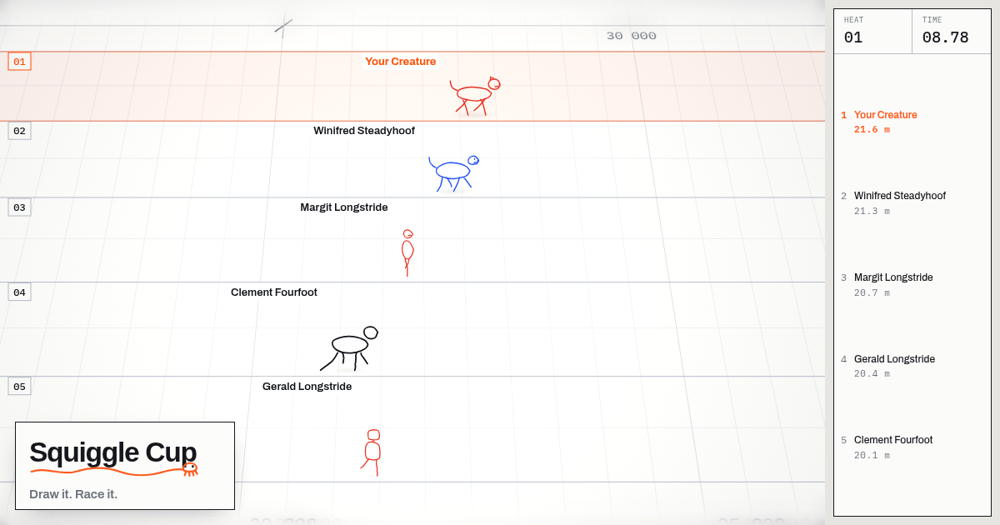
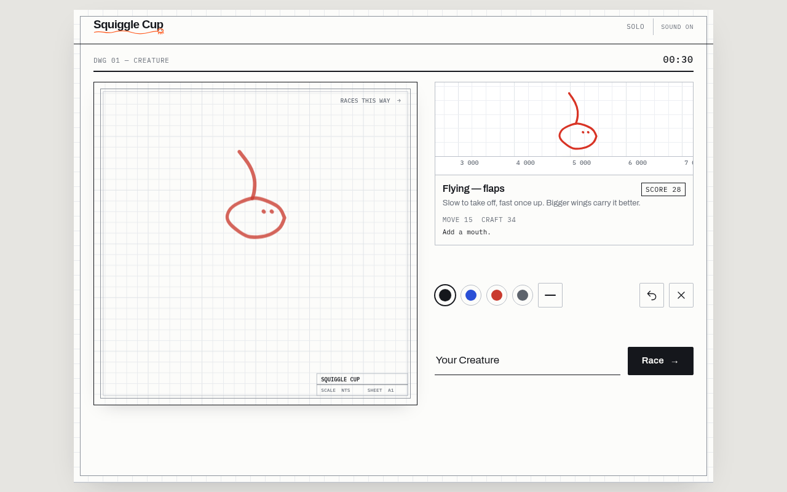
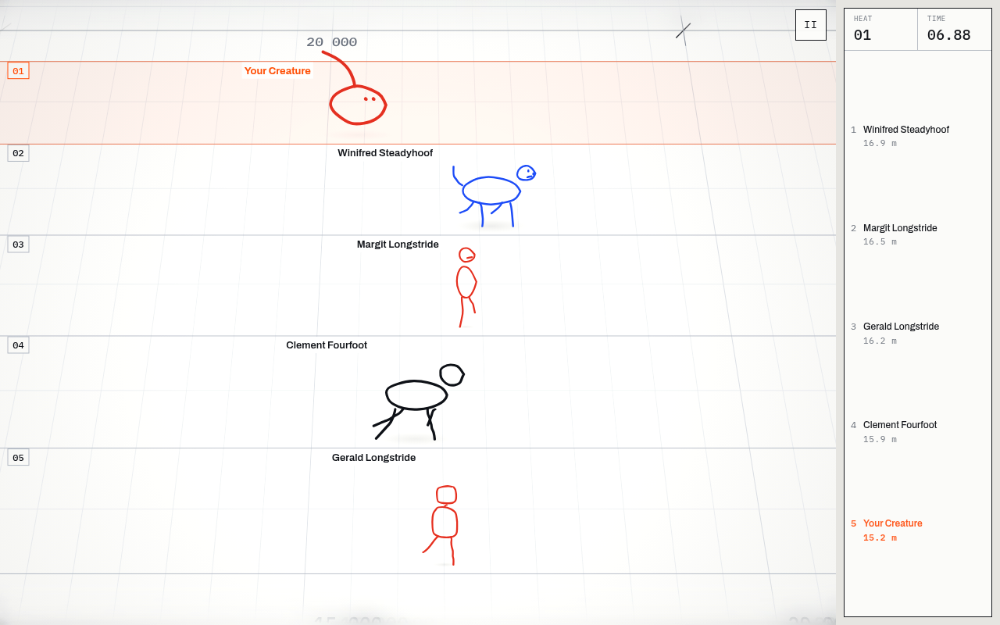
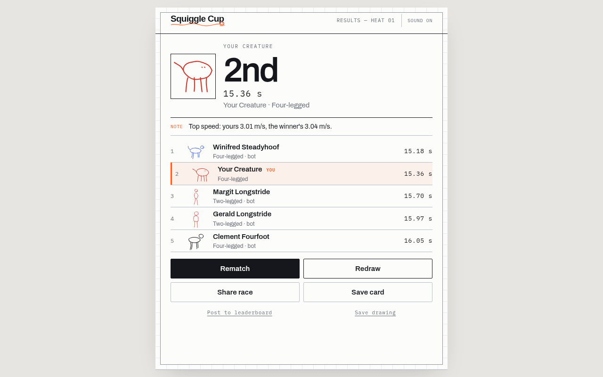
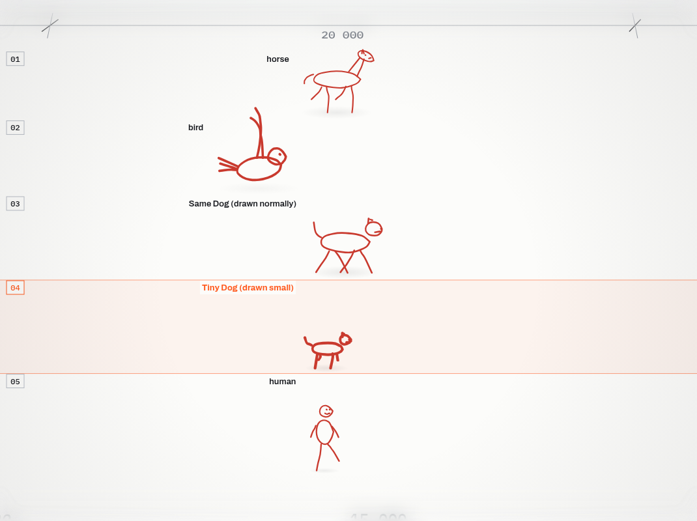
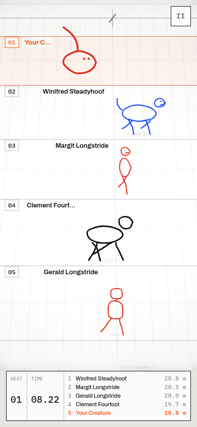
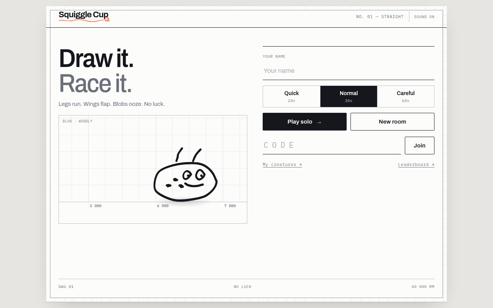

<div align="center">


**Draw it. Race it.**

A multiplayer drawing race. Sketch a creature in 30 seconds, then watch it run.<br>
The shape decides the motion: legs trot, wings flap, snakes slither.

[**▶ Play now**](https://squigglecup.pages.dev/) · [Worker mirror](https://squiggle-cup.ksmostofa576.workers.dev/)



</div>

---

## How it plays

| ✏️ Draw | 🏁 Race | 🏆 Results |
|:---:|:---:|:---:|
|  |  |  |
| A live preview runs your creature as you draw, with a score and one tip for what to add next. | Up to five racers on a tilt-shift architect's sheet. Your shape becomes your gait. | Rematch, redraw, share a replay link, save a result card, post to the leaderboard. |

## Features

- **Rooms with a four-letter code.** Play with friends, or solo against house creatures.
- **Ten creature families.** Horse, dog, cat, human, robot, bird, bat, snake, blob, many-legged.
- **Skill wins.** Speed comes from how well it's drawn: joined-up shapes, steady lines, eyes, feet, detail. Every kind shares the same best time, so no kind has a shortcut.
- **Fair and repeatable.** The same drawing always runs the same time, on every screen.
- **Verified leaderboard.** The server re-races every posted drawing; challenge any entry 1v1.
- **My creatures.** Every drawing you race is kept on your device, ready to race again.
- **Drawn to size.** Every creature looks the same size, unless you drew it small.

<div align="center">
<br>
<sub>Lane 3 and lane 4 are the same dog. Lane 4 was drawn small, so it looks small (it still races on equal terms).</sub>
</div>

<br>

<div align="center">
&nbsp;&nbsp;&nbsp;<br>
<sub>Built for phones first. Every screen's buttons fit without scrolling.</sub>
</div>

## Made together in trmi

Squiggle Cup was built in a weekend for **trmi × Lovhack × Nexus 2026**. The team used trmi as its shared space: one living spec, a progress board with every feature's status, and a running handoff, so anyone could pick up where someone else left off.

The big calls were made there, as a team:

- 🎨 **Plain ink on a white sheet.** A 3D look was tried, then dropped.
- ⚖️ **Strict scoring.** A great drawing should beat a quick one, and every kind should have the same ceiling.
- 📏 **One size for all.** Bigger creatures, no perspective shrinking, only small if drawn small.
- 🚗 **Vehicles later.** Wheels, cars and rockets get their own mode.

## Run it

```bash
npm ci
npm run dev          # game + relay + leaderboard on localhost
npm test             # simulation, balance, scoring, leaderboard
npm run test:browser # layout, rooms, leaderboard, pause (Playwright)
```

<details>
<summary>Deploy and testing notes</summary>

```bash
npx wrangler login
npm run deploy        # relay + game Worker (with the leaderboard Durable Object)
npm run deploy:pages  # same frontend on Cloudflare Pages
```

- Browser tests: set `PLAYWRIGHT_CHROMIUM_EXECUTABLE_PATH=/usr/bin/chromium` to use an installed Chromium, and `PLAYTEST_URL=<url>` to test a deployment (tests never post to a live leaderboard).
- `?demo=gallery` shows every house creature with its score; `?demo=board` opens the leaderboard.
- Changing the simulation or scoring? Bump `RULES` in `src/verify.ts`, then recalibrate with `node scripts/run-ts.mjs scripts/tune.ts`.
- `node scripts/og.mjs <dev url>` remakes the share image and video (needs ffmpeg).
- Spec: `PRD.md`. Progress and handoff: `prd/progress.json`.

</details>

<div align="center"><sub>Vite · TypeScript · Canvas · Cloudflare Workers + Durable Objects</sub></div>
